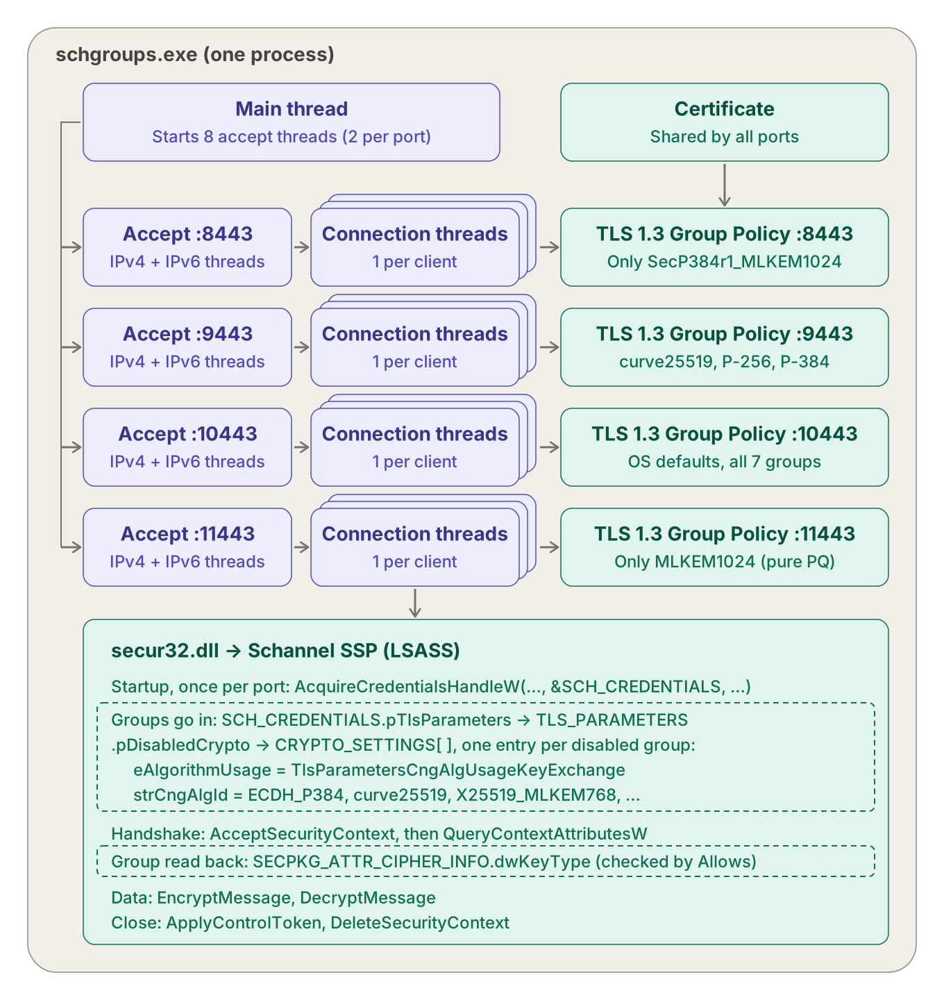

# schgroups

A Schannel TLS 1.3 server that can listen on one or more ports. On startup it:
1. listens on every port
2. shows the **OS default** key-establishment group list, once
3. for each port, applies that port's `--disable` or `--enable`
4. for each port, shows the resulting set, with every group marked ENABLED or disabled

The OS configuration is never changed.

## How it works



*Vector version: [docs/architecture.svg](docs/architecture.svg)*

The example shows the four-port setup used by `run-tests.ps1`.

- **Threads:** the main thread starts two accept threads per port, one for IPv4 (127.0.0.1) and one for IPv6 (::1). Each accept thread starts a connection thread for every client it accepts, up to 256 connections in total.
- **Per-port policy:** at startup the main thread calls `AcquireCredentialsHandleW` once per port. Each port gets its own credential, carrying that port's disabled groups, all built from the one certificate. A port's connection threads all use its credential.
- **Where the groups go:** each disabled group becomes one `CRYPTO_SETTINGS` entry in `TLS_PARAMETERS.pDisabledCrypto`, which `SCH_CREDENTIALS.pTlsParameters` points to. Its `eAlgorithmUsage` is `TlsParametersCngAlgUsageKeyExchange`, and `strCngAlgId` names the group: `ECDH_P256/384/521` for NIST curves, the group's own name otherwise.
- **Checking the result:** after each handshake, the connection thread reads the negotiated group from `QueryContextAttributesW(SECPKG_ATTR_CIPHER_INFO).dwKeyType`. If the port's policy doesn't allow it, the thread sends a fatal alert and closes. This catches groups Schannel lets through despite the disable.

## Walkthrough: reducing the default 7 groups to MLKEM1024 only

Pseudo-code for what `--port 11443 --enable MLKEM1024` does, using the real Win32 APIs and structures. Error handling and buffer management are left out; `schannel_groups.cpp` and `schgroups.cpp` have the full versions.

```cpp
#define SECURITY_WIN32
#define SCHANNEL_USE_BLACKLISTS        // exposes SCH_CREDENTIALS, TLS_PARAMETERS, CRYPTO_SETTINGS
#include <schannel.h>
#include <security.h>

// 1. Read the OS default list (precedence: GPO, then the TLS cmdlets, then the SSL provider).
//    HKLM\SOFTWARE\Policies\Microsoft\Cryptography\Configuration\SSL\00010002 : EccCurves (REG_MULTI_SZ)
//    else  Get-TlsEccCurve
//    else  SslOpenProvider(&hProv, MS_SCHANNEL_PROVIDER, 0);
//          SslEnumEccCurves(hProv, &count, &pCurves /* NCRYPT_SSL_ECC_CURVE[] */, 0);
defaults = { "SecP384r1_MLKEM1024", "X25519_MLKEM768", "curve25519", "MLKEM1024",
             "NistP384", "NistP256", "NistP521" };

// 2. --enable MLKEM1024 => disable everything else in the default list (6 groups).
//    NIST curves have documented CNG ids; other groups are passed by name.
LPCWSTR disabled[] = { L"SecP384r1_MLKEM1024", L"X25519_MLKEM768", L"curve25519",
                       BCRYPT_ECDH_P384_ALGORITHM,    // L"ECDH_P384"  (NistP384)
                       BCRYPT_ECDH_P256_ALGORITHM,    // L"ECDH_P256"  (NistP256)
                       BCRYPT_ECDH_P521_ALGORITHM };  // L"ECDH_P521"  (NistP521)

// 3. One CRYPTO_SETTINGS per disabled group.
CRYPTO_SETTINGS cs[6] = {};
for (i = 0; i < 6; ++i) {
    cs[i].eAlgorithmUsage = TlsParametersCngAlgUsageKeyExchange;
    RtlInitUnicodeString(&cs[i].strCngAlgId, disabled[i]);
    cs[i].cChainingModes  = 0;                 // no chaining modes for key exchange
}

// 4. Hang them off TLS_PARAMETERS, and that off SCH_CREDENTIALS.
TLS_PARAMETERS tp = {};
tp.grbitDisabledProtocols = SP_PROT_SSL2_SERVER | SP_PROT_SSL3_SERVER | SP_PROT_TLS1_0_SERVER
                          | SP_PROT_TLS1_1_SERVER | SP_PROT_TLS1_2_SERVER;   // TLS 1.3 only
tp.cDisabledCrypto        = 6;
tp.pDisabledCrypto        = cs;

SCH_CREDENTIALS sc = {};
sc.dwVersion      = SCH_CREDENTIALS_VERSION;
sc.cCreds         = 1;
sc.paCred         = &pCertContext;            // PCCERT_CONTEXT of the server cert
sc.dwFlags        = SCH_USE_STRONG_CRYPTO;
sc.cTlsParameters = 1;
sc.pTlsParameters = &tp;

// 5. One credential for the port. Schannel copies the structures; they can go out of scope after this.
CredHandle hCred;  TimeStamp ts;
AcquireCredentialsHandleW(NULL, UNISP_NAME_W, SECPKG_CRED_INBOUND, NULL, &sc,
                          NULL, NULL, &hCred, &ts);

// 6. Per client: handshake with the port's credential.
CtxtHandle hCtx;  bool first = true;
do {
    // in:  { SECBUFFER_TOKEN = bytes from the client, SECBUFFER_EMPTY }
    // out: { SECBUFFER_TOKEN, SECBUFFER_ALERT }   (ASC_REQ_ALLOCATE_MEMORY | ASC_REQ_STREAM | ...)
    status = AcceptSecurityContext(&hCred, first ? NULL : &hCtx, &inDesc, fContextReq, 0,
                                   &hCtx, &outDesc, &fContextAttr, &ts);
    send(out token);  first = false;
    // on failure: send the SECBUFFER_ALERT contents to the client, then close
} while (status == SEC_I_CONTINUE_NEEDED || status == SEC_E_INCOMPLETE_MESSAGE);

// 7. Read back the negotiated group and enforce the policy.
SecPkgContext_CipherInfo ci = { SECPKGCONTEXT_CIPHERINFO_V1 };
QueryContextAttributesW(&hCtx, SECPKG_ATTR_CIPHER_INFO, &ci);
if (ci.dwKeyType != 0x0202) {                 // 0x0202 = MLKEM1024 (IANA TLS NamedGroup)
    // Schannel ignored a name-based disable (seen with SecP384r1_MLKEM1024). Refuse after the fact:
    SCHANNEL_ALERT_TOKEN t = { SCHANNEL_ALERT, TLS1_ALERT_FATAL, TLS1_ALERT_HANDSHAKE_FAILURE };
    ApplyControlToken(&hCtx, &{ SECBUFFER_TOKEN, &t });
    AcceptSecurityContext(&hCred, &hCtx, NULL, ..., &outDesc, ...);   // produces the encrypted alert
    send(alert record);
    DeleteSecurityContext(&hCtx);
    close(socket);
}

// 8. Otherwise carry on: DecryptMessage / EncryptMessage, then close_notify via
//    ApplyControlToken(SCHANNEL_SHUTDOWN) + AcceptSecurityContext, DeleteSecurityContext.
//    At exit: FreeCredentialsHandle(&hCred).
```

Step 2 is the only part that depends on the mode. With `--disable`, the array holds just the named groups; with no option, it's empty and step 7 never refuses anything.

## Reusable module: `schannel_groups.h` / `.cpp`

All the group logic lives in a standalone module, with no logging, sockets or console I/O. It needs C++23 (`std::expected`). Copy the two files into another project, or link the `schannel_groups` CMake target.

| API | Purpose |
|---|---|
| `GetOsDefaultGroups()` | OS-configured group list: GPO, else `Get-TlsEccCurve`, else `SslEnumEccCurves`. Returns `std::expected<OsGroupList, wstring>` |
| `GroupPolicy::Build(base, Mode::Disable \| EnableOnly \| Defaults, names, &warnings)` | Resolves names (Windows, IANA or OpenSSL spellings) against the base list. Check `valid()` |
| `policy.Allows(groupId)` | Allowlist test for a negotiated code point; fails closed |
| `SchCredentialData(certs, policy, disabledProtocols)` | Owns an `SCH_CREDENTIALS` + `TLS_PARAMETERS` block if you call `AcquireCredentialsHandle` yourself |
| `AcquireServerCredential(cert, policy, kTls13OnlyServer)` | Returns `std::expected<Credential, SECURITY_STATUS>`; `Credential` frees the handle |
| `NegotiatedGroup(&ctx)` / `ViolatesPolicy(&ctx, policy)` | Post-handshake check of the negotiated group |
| `BuildFatalAlert(cred, &ctx)` | Encrypted fatal alert record to send before closing |
| `FindGroup(name\|id)`, `SameGroup`, `KnownGroups()` | Group catalog: names and code points |

```cpp
#include "schannel_groups.h"     // include after winsock2.h if you use sockets
auto os     = schgroups::GetOsDefaultGroups();                 // check os.has_value()
auto policy = schgroups::GroupPolicy::Build(os->groups, schgroups::Mode::EnableOnly, {L"SecP384r1_MLKEM1024"});
auto cred   = schgroups::AcquireServerCredential(cert, policy, schgroups::kTls13OnlyServer);
// ... handshake with cred->get() ...
if (schgroups::ViolatesPolicy(&ctx, policy))
    if (auto alert = schgroups::BuildFatalAlert(cred->get(), &ctx)) { /* send *alert, then close */ }
```

`ViolatesPolicy` fails closed. Once a policy restricts anything, a connection is a violation unless its group is a known code point that maps to an enabled group. A group that isn't reported at all (a TLS 1.2 RSA or DHE key exchange, or a failed query) counts as a violation.

## Build (VS 2026, MSVC v145, Windows SDK 10.0.28000+)

```
.\build.ps1                            # x64 Release (CMake)
.\build.ps1 -Arch arm64 -Config Debug
.\build.ps1 -NoCMake                   # Enter-VsDevShell + cl.exe directly
.\build.ps1 -Clean
```

## Run

```
schgroups --port 9443                                        # OS defaults, nothing changed
schgroups --port 9443 --disable curve25519                   # defaults minus curve25519
schgroups --port 9443 --enable X25519_MLKEM768,SecP384r1_MLKEM1024   # only these two

# several ports, one process
schgroups --port 8443 --enable SecP384r1_MLKEM1024 --port 9443 --disable X25519_MLKEM768,curve25519 --port 10443
schgroups --port 8443:enable=SecP384r1_MLKEM1024 --port 9443:disable=curve25519     # shorthand
```

- **Port scoping:** `--disable`/`--enable` apply to the `--port` before them. Given before any `--port`, they apply to every port that sets neither. A port with neither uses the OS defaults.
- **`--disable` and `--enable` are mutually exclusive per port.** `--disable` removes the listed groups from the default list. `--enable` keeps only the listed groups by disabling everything else.
- **Group names must match the OS list.** `--disable` with a group that isn't in the OS default list is an error and the server won't start. `--enable` warns about such a group and skips it, but fails if none of its groups are in the list. An empty list after either option is also an error.
- **Source of the OS default list,** in order of preference:
  - the Group Policy `ECC Curve Order` setting, if it is set
  - otherwise `Get-TlsEccCurve`
  - otherwise `SslEnumEccCurves`
- **Group names:** `curve25519`, `NistP256`, `NistP384`, `NistP521`, `X25519_MLKEM768`, `SecP256r1_MLKEM768`, `SecP384r1_MLKEM1024`. Case and underscores don't matter, and OpenSSL/IANA names such as `X25519MLKEM768` or `secp256r1` also work.
- **Cert:** by default the server makes a temporary RSA-3072 self-signed cert, and its key is deleted on exit. `--key p256` or `--key p384` gives you an ECDSA cert instead. In testing, an ECDSA cert made handshakes on ML-KEM hybrid groups fail with `SEC_E_ALGORITHM_MISMATCH` (no alert), while classical groups such as X25519 still worked. RSA worked for both. To use your own cert, pass `--cert <sha1>`; add `--machine` to read it from `LocalMachine\My`.
- **TLS 1.2:** `--tls12` also allows TLS 1.2; the default is TLS 1.3 only.

Each connection logs the protocol, cipher suite and negotiated group. The server also returns them in its HTTP response. To quit, type `q` and press Enter, or use Ctrl+C.

## Setting the OS default groups

`run-tests.ps1` expects the OS list to hold these 7 groups, in this order: 

- `SecP384r1_MLKEM1024`
- `X25519_MLKEM768`
- `curve25519`, 
- `MLKEM1024`, 
- `NistP384`, 
- `NistP256`, 
- `NistP521` 

To set them, run this from an elevated prompt:

```powershell
.\set-default-groups.ps1
```

It disables every group, then enables the seven in order, and prints the result.

- **Brief gap:** while it runs, the machine has no key-exchange groups, so new TLS connections can fail. If it stops partway through, run it again.
- **Group Policy wins:** a Group Policy `ECC Curve Order` setting overrides this.
- **Restart schgroups** afterwards; it reads the list once, at startup, this is just the way this code works, however.

## Testing with OpenSSL (3.5+)

```
openssl s_client -connect localhost:9443 -tls1_3 -groups X25519MLKEM768 -brief
```

If the group is disabled, the handshake fails.

## Full test matrix

`run-tests.ps1` runs 24 OpenSSL tests against the four-port setup: PQ hybrid only, classic only, OS defaults, and pure ML-KEM only. For each test it prints the expected and observed result and PASS/FAIL, then an overall result. The exit code is 0 on pass and 1 on fail.

```
.\schgroups.exe --port 8443 --enable SecP384r1_MLKEM1024 --port 9443 --enable curve25519,NistP256,NistP384 --port 10443 --port 11443 --enable MLKEM1024
.\run-tests.ps1                       # -OpenSsl <path>, -PqPort/-ClassicPort/-DefaultPort to override
```

## Security behaviour

- **Loopback by default.** The server listens on `127.0.0.1` and `::1` only. Use `--bind any` for all interfaces, or `--bind <ip>` for one address. Testing from another machine needs one of those.
- **Disabled groups are enforced after the handshake.** Schannel documents per-credential disable IDs only for the NIST curves (`ECDH_P256`, `ECDH_P384`, `ECDH_P521`). For curve25519 and the ML-KEM groups the server passes the group name, and in testing Schannel refused `X25519_MLKEM768` that way but let `SecP384r1_MLKEM1024` and `MLKEM1024` through. So after every handshake the server checks the negotiated group, and if the port doesn't allow it, sends a fatal `handshake_failure` alert and closes.
- **What that check can't do.** The client has already finished the handshake when it is refused, so its first application data may have been sent under the disallowed group. Only a group Schannel itself refuses, or an OS-wide `Disable-TlsEccCurve`, prevents that.
- **`--no-enforce`** turns the check off, to see what Schannel alone accepts.
- **TLS 1.2 (`--tls12`).** Client-initiated renegotiation is refused. On a port with restricted groups, a TLS 1.2 connection is refused unless Schannel reports an allowed group for it.
- **Limits.** At most 256 concurrent connections; 10 s for a handshake and 30 s for a whole connection.
